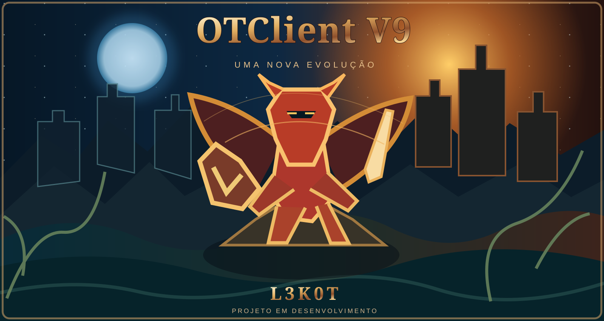
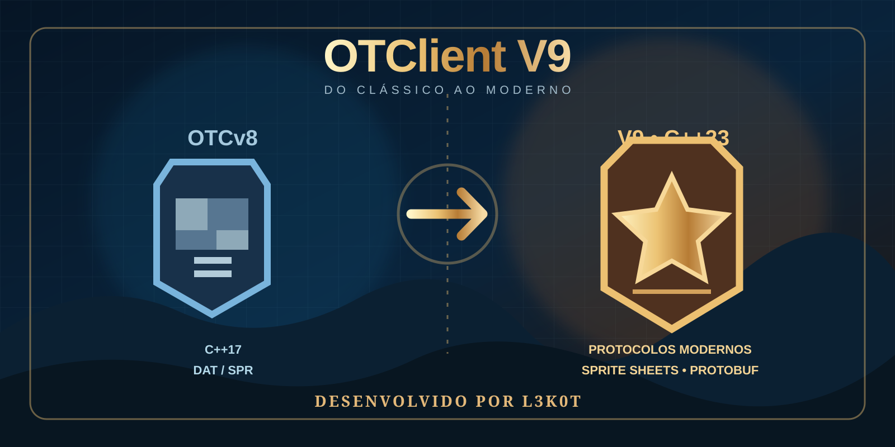

<b>🌐 Language / Idioma:</b> <a href="README.md">🇧🇷 Português</a> · <a href="README.en.md">🇺🇸 English</a> · <a href="README.es.md">🇪🇸 Español</a>

<a href="index.html">Site PT</a> · <a href="index-en.html">English site</a> · <a href="index-es.html">Sitio ES</a>

  

  # ⚔️ OTClient V9

  **The evolution of a classic codebase into a new generation of OTClient.**

  **C++23 · Modern protocols · Sprites and appearances · Modern Tibia systems**

  Developed and maintained by **L3K0T** · **Work in progress**

> ⭐ **Follow the evolution!** Click **Star** in the upper-right corner to support the project, and enable **Watch → All Activity** to receive updates and announcements.

---

## What is OTClient V9?

**OTClient V9** modernizes the **OTCv8** codebase while retaining its familiar Lua/OTUI ecosystem. The project introduces **C++23**, capability-based protocol profiles, support for modern asset formats not handled by the original upstream baseline, and integrations for newer Tibia systems.

**OTClient Redemption** serves as a reference and a source of appropriately credited adaptations for modern client systems. **Canary** serves as a reference for server and protocol behavior. Original copyrights and licenses remain with their respective authors.

## Major improvements

| Area | Original OTCv8 baseline | OTClient V9 evolution |
|---|---|---|
| Core | C++17 | Full-client compilation under **C++23** |
| Graphics | Classic **DAT/SPR** loader | Modern **sprite sheets**, catalogs, appearances and protobuf |
| Protocols | Traditional version-dependent implementation | **ProtocolProfile**, **ProtocolRegistry**, capabilities and GameFeatures |
| Game systems | Limited coverage of newer systems | Cyclopedia, Bosstiary, Forge, Wheel, Taskboard and other integrations |
| Build | Legacy build setup | CMake, vcpkg, smoke tests, CI for **Windows x64 and Linux** |
| Login | Legacy flows | Work on **HTTP / MyAAC / Canary 15.11** integration |

### 🎨 Next-generation sprites and assets

- Integrated `SpriteAppearances` and a modern loader for **compressed sprite sheets**.
- Support for `catalog-content.json` and `appearances.dat` through **Protocol Buffers**.
- Reading modern item, creature, outfit, and animation metadata.
- Version-specific asset handling while preserving legacy DAT/SPR support.
- Asset checks before connecting and synchronization fixes for sprite loading.

### 🧩 Added or adapted modules and systems

**Exploration and character:** Cyclopedia, Character Inspection, Bestiary, Bosstiary, Cyclopedia Houses, Blessings, and Main Panel.

**Combat and progression:** Exaltation Forge, Wheel of Destiny, Weapon Proficiency, Monk (Harmony and Serene), Attached Effects, and modern combat-related data.

**Tasks and rewards:** Taskboard, Soulseals, Reward Wall, Daily Rewards, and Resource Balance.

**Inventory and services:** Quick Loot, Supply Stash, Imbuement Tracker, and an updated Store.

**UI and quality of life:** Analyser, Health Circle, modern NPC Trade integrations, and adaptations to OTUI styles and Controllers.

**Important:** *Market, Prey, Action Bar, Imbuing, and NPC Trade already existed in the original OTCv8 baseline.* V9 fixes, adapts, or extends them for modern formats; these are not claimed as entirely new OTCv8 features.

### ⚙️ Engineering and stability

- Full C++23 builds validated in **Linux/GCC** and **Windows x64/MSVC** pipelines.
- Dependency fixes, modern Boost Asio integration, and C++/Lua compatibility improvements.
- Bounds-checked `PacketReader`, `PacketWriter`, and `SequenceManager`.
- CMake, vcpkg, compilation caching, and packaging Lua/OTUI/assets changes separately.
- Automated component checks and basic client startup smoke tests.

## Protocol support — real status

| Protocol | Goal | Current status |
|---|---|---|
| **8.60** | Preserve classic compatibility | Regression testing pending |
| **10.98** | Preserve transitional compatibility | Regression testing pending |
| **15.11** | Modern login/gameplay referencing Canary | Integration testing |
| **15.25** | Expand modern protocol support | Implementation and validation in progress |

> 🚧 **Important:** Code integration and successful compilation do **not** demonstrate fully working login, rendering, and gameplay across all targeted protocols. This repository is a **development showcase**, not a final release announcement.

## Public roadmap

- [x] Migrate full-client build to C++23.
- [x] Integrate modern sprite and appearances loaders.
- [x] Add protocol profiles/capabilities and modern modules.
- [x] Automate Windows and Linux build and packaging.
- [ ] Complete real-server login, movement, and graphics validation for 15.11.
- [ ] Validate modern systems and protocol changes through 15.25.
- [ ] Run legacy regressions and extended stability testing.
- [ ] Announce the first BETA distribution after the required validation.

## ⭐ Star and follow the project

Interested in OTServ and OTClient development? **Star this repository** to support OTClient V9, and use **Watch** to follow updates, progress reports, and upcoming releases.

**Public development news and release announcements will be posted here.**

**Developer:** [L3K0T on GitHub](https://github.com/l3k0t)

---

This public showcase does not contain the private client source code, internal build files, credentials, official Tibia game assets, or client binaries. OTCv8, OTClient Redemption, and third-party projects retain their original authorship and license terms. Illustrations do not represent actual in-game screenshots.
