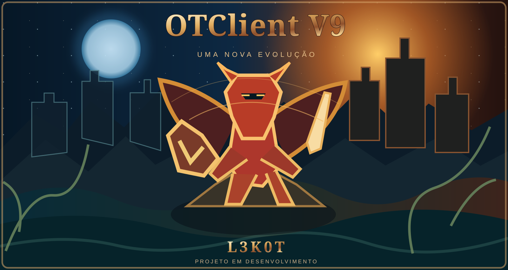
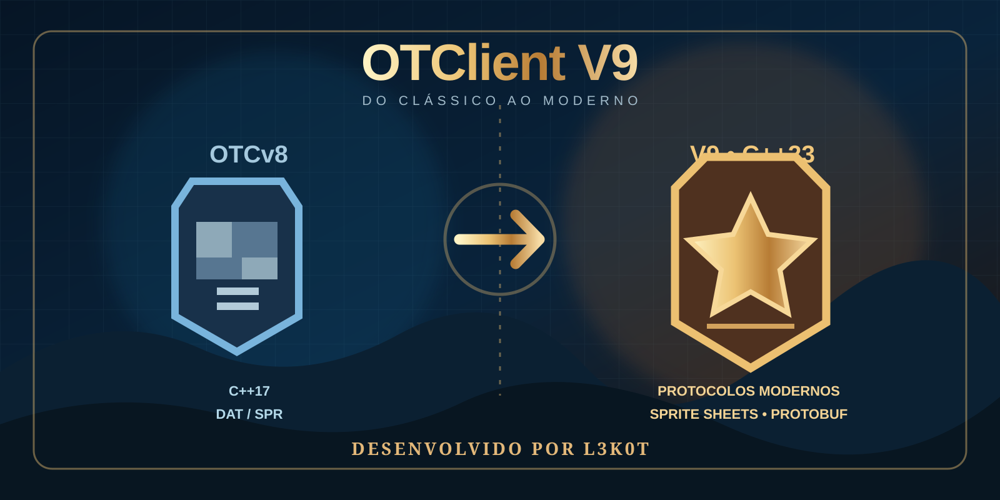

<b>🌐 Language / Idioma:</b> <a href="README.md">🇧🇷 Português</a> · <a href="README.en.md">🇺🇸 English</a> · <a href="README.es.md">🇪🇸 Español</a>

<a href="index.html">Site PT</a> · <a href="index-en.html">English site</a> · <a href="index-es.html">Sitio ES</a>

  

  # ⚔️ OTClient V9

  **La evolución de una base clásica hacia una nueva generación de OTClient.**

  **C++23 · Protocolos modernos · Sprites y appearances · Nuevos sistemas de Tibia**

  Desarrollado y mantenido por **L3K0T** · **Proyecto en desarrollo**

> ⭐ **¡Sigue la evolución!** Pulsa **Star** para destacar el proyecto y activa **Watch → All Activity** para recibir novedades y anuncios.

---

## ¿Qué es OTClient V9?

**OTClient V9** moderniza la base de **OTCv8** conservando su conocido ecosistema Lua/OTUI. El proyecto incorpora **C++23**, perfiles de protocolo basados en capacidades, compatibilidad estructural con formatos gráficos modernos ausentes del cargador original y la integración de sistemas recientes de Tibia.

**OTClient Redemption** sirve como referencia y fuente de adaptaciones acreditadas de sistemas modernos. **Canary** es la referencia para el comportamiento del servidor y sus protocolos. Se mantienen los derechos y las licencias de los autores originales.

## Principales mejoras

| Área | Base original OTCv8 | Evolución de OTClient V9 |
|---|---|---|
| Núcleo | C++17 | Compilación del cliente completo con **C++23** |
| Gráficos | Carga clásica **DAT/SPR** | **Sprite Sheets**, catálogos, appearances y protobuf |
| Protocolos | Implementación tradicional por versiones | **ProtocolProfile**, **ProtocolRegistry**, capacidades y GameFeatures |
| Sistemas de juego | Cobertura limitada de sistemas modernos | Cyclopedia, Bosstiary, Forge, Wheel, Taskboard y más |
| Compilación | Herramientas tradicionales | CMake, vcpkg, pruebas y CI para **Windows x64 y Linux** |
| Inicio de sesión | Flujos heredados | Integración **HTTP / MyAAC / Canary 15.11** en desarrollo |

### 🎨 Sprites y recursos gráficos modernos

- Integración de `SpriteAppearances` y carga de **Sprite Sheets comprimidas**.
- Soporte para `catalog-content.json` y `appearances.dat` mediante **Protocol Buffers**.
- Lectura de datos modernos de objetos, criaturas, outfits y animaciones.
- Selección de recursos según la versión, manteniendo la carga DAT/SPR para protocolos antiguos.
- Comprobación de archivos antes de la conexión y correcciones de sincronización de sprites.

### 🧩 Módulos y sistemas añadidos o adaptados

**Exploración y personaje:** Cyclopedia, Character Inspection, Bestiary, Bosstiary, Cyclopedia Houses, Blessings y Main Panel.

**Combate y progreso:** Exaltation Forge, Wheel of Destiny, Weapon Proficiency, Monk (Harmony y Serene), Attached Effects y datos de combate modernos.

**Tareas y recompensas:** Taskboard, Soulseals, Reward Wall, Daily Rewards y Resource Balance.

**Inventario y servicios:** Quick Loot, Supply Stash, Imbuement Tracker y Store actualizada.

**Interfaz y comodidad:** Analyser, Health Circle, integración del NPC Trade moderno y adaptación de estilos OTUI y Controllers.

**Nota:** *Market, Prey, Action Bar, Imbuing y NPC Trade ya existían en la base OTCv8.* V9 los corrige, adapta o amplía para formatos actuales; no se presentan como sistemas totalmente nuevos.

### ⚙️ Ingeniería y estabilidad

- Compilación completa en C++23 validada en los pipelines **Linux/GCC** y **Windows x64/MSVC**.
- Correcciones de dependencias, actualización de Boost Asio y mejoras de compatibilidad C++/Lua.
- `PacketReader` con verificación de límites, `PacketWriter` y `SequenceManager`.
- CMake, vcpkg, caché de compilación y empaquetado independiente de cambios Lua/OTUI/assets.
- Pruebas automáticas de componentes y pruebas básicas de inicio del cliente.

## Estado real de los protocolos

| Protocolo | Objetivo | Estado |
|---|---|---|
| **8.60** | Mantener compatibilidad clásica | Pruebas de regresión pendientes |
| **10.98** | Mantener compatibilidad de transición | Pruebas de regresión pendientes |
| **15.11** | Login y juego modernos con Canary como referencia | Integración en pruebas |
| **15.25** | Ampliar la compatibilidad moderna | Implementación y validación en curso |

> 🚧 **Importante:** Integrar código y compilar correctamente **no equivale** a demostrar que el login, los gráficos y la jugabilidad funcionen por completo en todos los protocolos. Este repositorio es una **presentación del desarrollo**, no una versión final.

## Hoja de ruta pública

- [x] Modernizar la compilación del cliente completo a C++23.
- [x] Integrar los cargadores modernos de sprites y appearances.
- [x] Añadir perfiles de protocolo, capacidades y módulos modernos.
- [x] Automatizar compilación y empaquetado para Windows y Linux.
- [ ] Completar las pruebas reales de conexión, movimiento y gráficos en 15.11.
- [ ] Validar los sistemas modernos y las diferencias de protocolo hasta 15.25.
- [ ] Ejecutar regresiones de versiones clásicas y pruebas prolongadas de estabilidad.
- [ ] Anunciar la primera versión BETA después de las validaciones necesarias.

## ⭐ Dale una estrella y sigue las novedades

¿Te interesan OTServ y OTClient? **Dale una estrella (Star)** a este repositorio y activa **Watch** para estar al día con las mejoras, noticias y próximas versiones.

**Las novedades públicas y los futuros anuncios se publicarán aquí.**

**Desarrollador:** [L3K0T en GitHub](https://github.com/l3k0t)

---

Esta presentación pública no incluye el código fuente privado, herramientas internas de compilación, credenciales, recursos oficiales de Tibia ni binarios del cliente. OTCv8, OTClient Redemption y las demás dependencias mantienen los créditos y licencias de sus autores. Las imágenes son ilustrativas y no representan capturas reales del juego.
